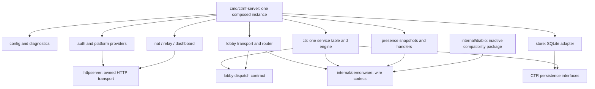

# Common Demonware protocol and compatibility contract

Decision: 2026-10-14. Extract the existing lobby wire implementation into
`internal/demonware`, in the existing Go module, repository and executable.
Game services, identity admission and persistence stay in the application.
The package has only standard-library dependencies and owns no listeners,
goroutines, clocks, configuration, registries or mutable global state.
The PolyForm Shield license and original attribution remain unchanged.

This is a specification of the dialect implemented here, not an official
Demonware specification or a claim that every Demonware game is compatible.
The current executable admits CTR PS4 title **5760** only. Retaining Diablo
handlers and fixtures does not restore Diablo login or qualify Diablo PS4.

## Evidence and scope

Pinned source lineage:

- Original Nextendo: `c3400c312a739cf7598204a981156959910ed874`.
- Fork immediately before extraction: `c16b085`.
- Historical clients: Diablo III Switch (title 5745), CTR Switch (5775).
  The active fork targets CTR PS4 CUSA13795 01.21 (5760).

Evidence labels follow the workspace convention: **F** owned firmware,
**C** original game/caller bytes, **U** upstream source and its reconstruction
claims, **H** public reverse-engineering work, **P** provider documentation,
**S** general standards, **I** inference or replacement/design policy.
No new firmware/game disassembly or live Diablo session was performed for this
extraction. Tests are regression evidence, not an additional source class and
not proof of original production-server policy.

Upstream's retained [historical README](HISTORICAL_SWITCH_README.md#crash-team-racing) reports the same
lobby protocol for CTR and Diablo and a Diablo login/create/find test on the
merged server (**U**). Its known limits explicitly say live Diablo rich presence
was not demonstrated. The source comments retain D3 NSO addresses; those addresses
remain upstream evidence, not independently verified PS4 offsets.

The workspace's existing CTR compatibility, bootstrap and race records provide
CTR-specific evidence. For example, PS4 send sequence `conn+0x260` and receive
check `0x1ac33` are recorded in [FORK.md](../FORK.md#design) (**C**).
No historical in-game result qualifies this newly refactored binary automatically.

## Shared behavior matrix

| Contract | CTR evidence | Diablo evidence | Boundary and executable checks |
| --- | --- | --- | --- |
| Version negotiation, framed lobby, ticket-key handshake | Existing PS4 admission/integration fixtures; earlier local client acceptance | D3 NSO layout and upstream merged-server report (**U**) | Common wire code; `TestHelloAndTranscriptLayout`, `TestFrameBoundariesAndKeepalive`, original admission tests. Identity and ticket validity remain application policy. |
| SHA-1 key derivation, directional AES-CBC and truncated MAC | Existing encrypted CTR flow; fixed pre-refactor vectors | Inherited `bdcrypto.go` D3 reconstruction (**U**) | `TestPreRefactorWireVectors`, `TestEncryptedFrameTamperingAndBounds`. Algorithm compatibility does not establish shared credentials or trust. |
| Typed arguments, task/result envelopes | CTR task/reply fixtures, structured HTTP envelope assertions | D3 task reader notes and inherited handlers (**U**) | `Reader`, `Writer`, reply functions. A shared service number or envelope does not establish the same payload schema. |
| Rich presence 68/3 argument shape | `TestCTRRichPresenceRoundTrip`, a synthetic inherited Switch fixture | `TestRichPresenceFromTheRealLog`, literal bytes described upstream as a D3 login capture (**U**) | Same context/account/platform/flag/blob shape in `richpresence.go`. Payload contents, platform ID mapping and live friend visibility remain unqualified across games. |
| Presence state and disconnect cleanup | Existing presence/online-state tests | Same inherited implementation; no independent live D3 friend visibility proof | Application behavior (**I/U**), not a codec rule. Kept out of the package. |
| Session IDs, typed blobs and result framing | CTR contextual matchmaking tests | D3 service-21 handlers and upstream create/find report (**U**) | Shared serialization; game attributes, search filters, party/merge rules and race transport stay outside. No claim of one matchmaking algorithm for every game. |
| Struct buffers and HTTP proxy reply variant | CTR assertions, including immediate StructStart and both status fields | Shared SDK-shaped implementation; no independent D3 acceptance fixture for every variant | Generic wire helpers are reusable; this is not a claim that every variant was exercised by both games. |
| Inventory, prices, coins, rewards, achievements | CTR-specific rules and tests | No implemented equivalent economy establishes parity | Remain in `ctr_*` and the CTR database. Similar names are insufficient evidence for a shared domain model. |
| Leaderboards, hero data, seasons | CTR leaderboard implementation and independent SQLite contract tests | Inherited D3 stats/hero-upload paths include stub responses; seasonal publisher data differs | Only codecs are common. No shared persistence or progression model is inferred. |

The presence fixtures are a concrete overlap **above** primitive framing, but
their evidence is deliberately asymmetric: one upstream-described log fragment
and synthetic CTR tests. They do not prove a complete shared game backend.

## Package and application responsibilities

Arrows describe composition/dependencies, not additional services or network
APIs. The entrypoint injects the CTR table into the lobby; the lobby never
imports CTR. SQLite implements CTR's consumer-owned interfaces; CTR never
imports the adapter. No admitted title or production entrypoint reaches Diablo.
`httpserver` owns only the existing auth/dashboard transports. The protocol
package and its original vectors are unchanged by the architecture refactor.

Dependencies point from services to the wire package. It cannot import package
`main`, platform adapters, SQLite or game rules. A future game can supply its own
handlers without modifying primitive serialization. `internal/` prevents use
as an accidental external SDK; there is no new `go.mod`, release or service API.

| Package file | Responsibility | Caller must supply or decide |
| --- | --- | --- |
| `buffer.go` | Typed values, bounded cursor, legacy uint64 arrays | Argument schema, ownership checks, context and trailing-byte policy |
| `struct.go` | Varints, byte fields, structured wrapper | Field meanings, nesting, required fields and domain limits |
| `reply.go` | Ordinary, paginated, structured and HTTP proxy envelopes | Transaction number, result rows, status/error choice |
| `frame.go` | Hello/transcript encoding, bounded frame reads, encrypted envelopes, ticket bit extraction | Exact-read callback, deadlines, identity, ticket validity, sequence admission, fresh IV, dispatch |
| `crypto.go` | Existing key derivation, MAC and block encryption | Directional key selection, public wrapping label and trust policy |

The wrapping public-key label stays in `internal/lobby/pubkey.go`. It is an explicit
input to `WrapKey24`, not a universal trust anchor embedded in the package.
`FindTicket` only extracts bytes; admission still requires a fresh locally issued
ticket bound to its identity. Auth signing, shadNet verification, anonymous guests,
HTTP listeners, NAT/relay, migration decisions and live session duration are outside.

## Wire contracts

All fixed-width integers below are little-endian. `typed T` includes the tag.

1. **Hello:** exactly 28 unframed bytes: `u32 200 | u32 200 | u32 210 |
   u32 220 | u32 maxFrame | nonce[8]`. The selected version is 220.
   These accepted values describe the existing dialect, not a general negotiator.
2. **Frame:** `u32 L | 0xAB | type | body`, where L excludes its own four bytes.
   L=0 is a keepalive. Reads reject lengths above the offered maximum or 2 MiB.
   The caller supplies an exact-read function and handles connection errors.
3. **Handshake:** server 0x81 payload is `u32 220 | u64 serverID | padding[8]`.
   Transcript is `u32 210 | u32 220 | u32 maxFrame | nonce[8] |
   u32 (len(serverPayload)+2) | AB 81 | serverPayload | clientAuthWithoutProof`.
   The last term includes the 0x82 frame's original length/flag and excludes
   only its final eight-byte proof.
4. **Keys:** `secret = HMAC-SHA1(SHA1(transcript), key24)`. Expand labels
   `CLIENTCHAL` (16 bytes) and `BDDATA` (72 bytes). The former splits into two
   eight-byte proofs; the latter into client/server MAC keys (20 each), then
   client/server AES keys (16 each). The optional wrapping variant expands
   the ticket key using the caller-provided DER bytes as label.
5. **Encrypted frame:** `u32 L | AB 85 | u32 sequence | IV[16] |
   ciphertext | MAC[8]`. MAC covers all preceding bytes including length.
   Plaintext is `u32 payloadLength | innerType | payload | zero padding`
   to a 16-byte boundary. This is the existing AES-CBC wire format, not PKCS#7.
   Inner types are request 0x86, reply 0x01 and push 0x02.
6. **Typed values:** bool 01, uint8 03, uint16 06, int32 tag 07,
   uint32 08, int64 09, uint64 0A, NUL-terminated string 10,
   blob 13 and structured buffer 17. Blob/struct lengths are *typed uint32*.
   Only the readers/writers actually needed by existing services are exposed;
   declaring a tag does not promise a complete SDK implementation.
7. **Task request:** raw service byte, typed uint8 task, then service-owned
   arguments. Ordinary reply: typed transaction, typed error; on success,
   typed task and typed result count. Only a nonempty result list has a typed
   total count and result body. Paginated totals may exceed the page count.
   Error replies stop after the error code. The tagged transaction form is
   retained for the inherited LSG path; other SDK reply paths are not inferred.
8. **Structured reply:** transaction, zero error and task, followed immediately
   by StructStart/length/body; no ordinary result counts. HTTP proxy bodies
   contain varint status fields 1 and 2 and bytes field 3. These are two SDK
   deserializers, not evidence from two independently tested games.
9. **Push:** inner type 0x02 contains a typed uint32 event followed by a
   service-owned payload. Event IDs and recipient selection remain application code.

`ParseFields` supports wire types 0 and 2 only, with the existing limits of
1 MiB and 4096 fields per buffer. It rejects field zero, malformed varints,
unsupported wire types and truncated byte fields. It does not validate schemas
or recursively parse nested messages. `TaskStructPayload` checks the wrapper
at the existing three-byte task-header offset, not the service/task themselves.

`Reader` borrows its input; `Remaining` and structured field data are borrowed
views. `Blob` and `RequestTail` copy. A failed read may consume a valid tag, so
callers must stop or deliberately recover after an error. `Uint64s` intentionally
keeps legacy permissive behavior: return complete values before a malformed tail.
`RequestTail` removes one terminal NUL without advancing the cursor; it is not
terminator validation. A zero `Writer` works; `NewWriter` copies its prefix and
`Bytes` returns a borrowed view which callers must not mutate.

`ParseEncryptedFrame` checks minimum size, and `Verify` authenticates the raw
bytes. The application must verify before decrypting and decide whether the
message type/sequence is acceptable. It retains the existing sequence policy:
bad MAC, replay or a gap neither dispatches nor advances; an authenticated next
frame consumes its sequence even if its decrypted envelope is malformed.
The parser does not independently revalidate the outer frame length/flag;
network framing remains the responsibility of `ReadFrame` and its caller.

## Refactor decisions and acceptance

The useful SOLID improvement is responsibility separation and explicit inputs:
private parsing state, pure serialization, transport injected as an exact-read
callback, and policy owned by application services. Concrete functions and small
types suffice. No unused service interfaces, generic inventory hierarchy,
plugin registry or extra process is introduced. This follows Go's
[internal-package layout guidance](https://go.dev/doc/modules/layout) and
[small behavior-oriented interfaces](https://go.dev/doc/effective_go#interfaces).

The initial protocol extraction renamed `ctr_presence.go` to `richpresence.go`.
The subsequent architecture refactor moved it to `internal/presence`, extracted
owned components and wired one CTR table. Diablo's table and generators are now
inactive. The [architecture inventory and fixture ledger](ARCHITECTURE_REFACTOR.md)
record the allowed disconnection changes; all other dispatcher snapshots retain
their original bytes and state. The [final report](ARCHITECTURE_REFACTOR_REPORT.md)
records package moves, lifecycle verification and the new parser fuzz run.

Compatibility checks use fixed synthetic outputs recorded from **c16b085 before
extraction**, stored in `internal/demonware/testdata/pre_refactor.json`. The fixture
also includes the already-public wrapping label. It contains no live ticket,
account or signing key. `TestPreRefactorWireVectors` compares exact bytes for
typed values, reply variants, proofs, directional keys and encrypted envelopes.
Independent existing integration fixtures in `cmd/ctrnf-server` still construct requests/replies manually.

Small robustness changes are explicit: invalid IV lengths return errors rather
than panicking; malformed lengths cannot overflow slice bounds; field tags above
31 are encoded as complete varints; MAC/proof comparisons use `hmac.Equal`; an
invalid-MAC frame is no longer decrypted for diagnostics. Current valid wire
vectors are unchanged. The application still enforces admission and sequence
policy, covered by `TestEncryptedFrameRejectionPreservesSequencePolicy` and the
original replay/admission tests.

Validation: 370 named tests/subtests passed, together with `go vet ./...` and a
server build. Dependency inspection found only standard-library imports beneath
`internal/demonware`. A 15-second parser fuzz run completed 340,577 executions
without a failure. The race detector was not run (no configured cgo compiler).
On 2026-10-14 the user accepted the installed `33dc1c6` build with shadNet A/B:
shared lobby and races through results. The matching server-log segment records
matched searches, accepted lobby synchronization, leaderboard uploads and
persisted rewards, with no MAC errors. Guest C/D remained on the previous build;
LAN/WAN and live Diablo compatibility remain unqualified. Profile B crashed once
on `Game:Main` (`0xc0000005`) about five seconds after the first match notification,
without recurrence after restart; the cause is open and unattributed. This
acceptance does not automatically qualify the subsequent architecture refactor.

## Reusing this for another game

Treat compatibility as a set of contracts to demonstrate. Obtain lawful client
evidence or captures for the specific game/platform/version; identify its hello,
transcript, keys, frame dialect and task envelopes; add independent byte fixtures
and negative cases; implement its admission and service schemas in the application;
then qualify a real login and required operations before claiming game support.
Record unsupported variants explicitly. Do not weaken CTR admission, share its
economy database or assume identical catalog/reward rules to make a new client fit.

This establishes a reusable protocol boundary and a way to test future reuse.
It does not establish how Demonware organizes its own production backend or
which third game will be compatible without further evidence.
## JSON compatibility references

The code-quality cleanup records JSON on the unchanged `06912ba` implementation
before renaming any fields. Each package's `json_reference_test.go` and
`testdata/json_reference.json` cover zero and populated values, exact Marshal
bytes, Encoder's trailing newline, and decoding a saved input into the original
value. Anonymous wire structs are also checked against their production source
shape so that a copied test declaration cannot silently diverge. Fixtures contain
synthetic data only and have no regeneration mode.

| Owner / reference test | Reachable types and use |
| --- | --- |
| auth / `TestJSONReferenceAuth` | Anonymous authentication request and ordered response; `map[string]string` platform extra data. |
| config / `TestJSONReferenceConfig` | News `map[string]string` (`content_long`). Config and news wrapper structs are not JSON-encoded. |
| ctr / `TestJSONReferenceCtr` | `SearchDoc` including slots/rules/filter and RawMessage values; `PlayerInfo` including listen-server fields; dynamic host/backend documents (`map[string]any`, string maps, JSON numbers); `lobbyHostDoc`, `lobbyListenServer`, `lobbyTeamBalance`, anonymous uploaded-address and Umbrella request/response shapes, `jsonUint32`. |
| ctr / same test | `economySKU` and its uint32-keyed catalog; `EconomyAccount`, `ChallengeCompletion`, `PitStopRefreshRecord`; legacy uint64-keyed balances and SKU slices; receipt, item and online-seconds maps. |
| ctr / same test | `challengeSchedule`, `ChallengeRule`, `challengePeriod`, `windowShoppingRule`; `raceRate` and its uint64-keyed map; `AchievementEvent` receipt input; `Stat` in the nested board/player map (Rank excluded). |
| dashboard / `TestJSONReferenceDashboard` | `/api/stats`: `APIStats`, `apiServer`, `apiPlayer`, `APIGathering`, `APILobbyPlayer`, `apiEvent`, `apiMethod`, including the optional gathering code. |
| diablo / `TestJSONReferenceDiablo` | `pubConfig`, `riftSettings`, `seasonRotation`, `seasonEvents` and season-theme maps; the existing season tests also cover the alternate event-object decoding. |
| platform/ps4 / `TestJSONReferencePlatformPs4` | Anonymous PSN outer request, token and id-token envelopes; strict-object RawMessage maps and platform extra-data string maps. |
| platform/guest / `TestJSONReferencePlatformGuest` | Platform extra-data string map. |
| platform/shadnet / `TestJSONReferencePlatformShadnet` | Anonymous JWKS set/JWK, JWT header/claims; RawMessage maps, trust-ID string tuple; `Policy` retained as an additional data-contract reference. No real keys or credentials. |
| store / `TestJSONReferenceStore` | SQLite JSON columns: challenge receipt `map[string]uint64`, challenge distinct and refresh receipt `map[string]bool`, ledger receipt `[]string` and ledger SKUs `[]uint32`. Existing adapter tests cover save/reopen and ledger persistence. |
| strictjson / `TestJSONReferenceStrictjson` | RawMessage and dynamic-object destinations. Existing strict decoder tests cover UseNumber, duplicate keys, unknown fields, depth and trailing values. |

Nested types are exercised through their root values. The shared wire package
does not serialize production JSON; its JSON use loads test fixtures. The
architecture dispatcher fixture remains unchanged: 648 snapshots with exactly
the existing 12 service-21 Diablo disconnection exceptions. No schema or SQL
change accompanies these references.
